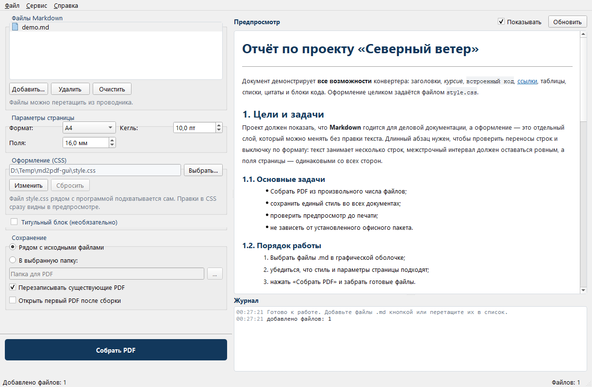
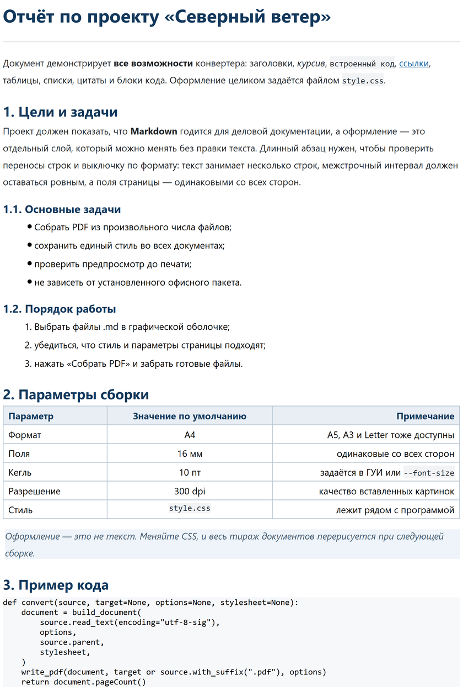
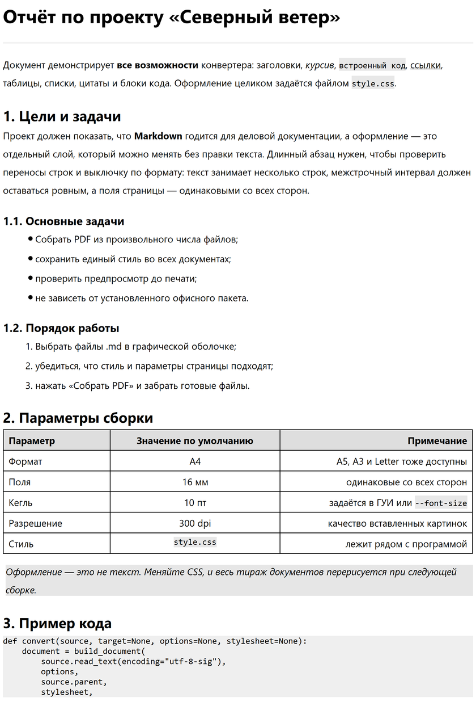

# MD2PDF — Markdown в PDF

Переносимый конвертер Markdown в PDF с графической оболочкой. Разметка
переводится в HTML и печатается в PDF средствами Qt, поэтому не нужны
офисный пакет, Microsoft Word или интернет. Оформление задаётся отдельным
файлом `style.css` с подробными комментариями и меняется без правки кода.

## Быстрый старт (переносимая версия)

В папке сборки лежат:

    md2pdf-gui.exe     программа (Python и Qt внутри)
    style.css          цветное оформление документов
    monochrome.css     оформление для чёрно-белой печати
    README.md          эта инструкция
    design\            main_window.ui — дизайн окна для Qt Designer
    docs\              картинки для этой инструкции
    examples\          пример разметки demo.md и картинка к нему

1. Запустите `md2pdf-gui.exe`.
2. Нажмите «Добавить…» (Ctrl+O) и выберите один или несколько файлов `.md`.
   Файлы можно просто перетащить в список из проводника.
3. Проверьте вид справа: предпросмотр использует тот же CSS, что и PDF.
4. Нажмите «Собрать PDF». Готовые файлы появятся рядом с исходными
   (или в выбранной папке).

Устанавливать ничего не нужно. Файл `style.css` должен лежать рядом
с `md2pdf-gui.exe` — его можно править любым текстовым редактором,
пересобирать программу для этого не требуется.

> **Если Windows покажет предупреждение SmartScreen** («Windows защитила ваш
> компьютер»), нажмите «Подробнее» → «Выполнить в любом случае». Сборка не
> подписана сертификатом, поэтому система относится к ней настороженно.
> То же касается антивируса: самодостаточные exe иногда попадают под
> эвристику — файл можно проверить или собрать самостоятельно по инструкции
> ниже.

Пример страницы, собранной из `examples/demo.md` со стилем по умолчанию:

## Что умеет графическая оболочка

* Выбор **нескольких** файлов `.md` за один раз и перетаскивание из проводника.
* Список файлов с удалением и очисткой; предпросмотр выбранного файла.
* Формат страницы (A4, A5, A3, Letter), кегль основного шрифта и поля.
* Титульный блок: заголовок, подзаголовок, примечание (по умолчанию берётся
  первый заголовок `#` из файла).
* Выбор другого файла `.css`, открытие стиля в редакторе и сброс на
  `style.css` рядом с программой.
* Сохранение PDF рядом с исходными файлами или в выбранную папку,
  защита от случайной перезаписи.
* Сборка в отдельном потоке, прогресс, журнал ошибок по каждому файлу.
* Настройки (размер окна, параметры, папка, стиль) запоминаются.

Горячие клавиши: Ctrl+O — добавить файлы, Delete — убрать из списка,
Ctrl+Enter — собрать PDF, F5 — обновить предпросмотр, Ctrl+Q — выход.

## Дизайн интерфейса (Qt Designer)

Разметка окна лежит в `design/main_window.ui` — это обычный файл
Qt Designer. Приложение читает его при запуске через `uic.loadUi`,
поэтому после правок в дизайнере достаточно перезапустить программу.
`pyuic5` и пересборка для запуска из исходников не нужны.

Как поменять расположение элементов:

1. Откройте `design/main_window.ui` в Qt Designer 5.15. В этой системе
   уже есть `designer.exe`; подойдёт и Qt Creator.
2. Перетаскивайте виджеты, меняйте layout-менеджеры, отступы и размеры.
3. Сохраните файл и перезапустите `python md2pdf_gui.py`.
4. В переносимой версии правьте `dist\design\main_window.ui` рядом с exe:
   внешний файл имеет приоритет над встроенным, пересборка не требуется.
   Либо пересоберите `build_exe.ps1` — он копирует дизайн в `dist`.

Важно:

* имена объектов (`fileList`, `convertButton`, `preview`, `cssEdit` …) —
  это контракт с кодом; переименование или удаление сломает приложение.
  При запуске выполняется проверка и выводится список недостающих объектов;
* `FileListWidget` — продвинутый (promoted) виджет из
  `md2pdf_widgets.py`: в Designer он выглядит как QListWidget,
  а перетаскивание файлов реализовано в коде;
* титульный блок — checkable QGroupBox: в Designer он раскрыт для удобства,
  в приложении стартует свёрнутым;
* используйте layout-менеджеры, а не абсолютные координаты: иначе окно
  поедет при изменении размера и на другом DPI;
* альтернативный дизайн можно проверить через переменную `MD2PDF_UI`
  (путь к .ui), не трогая основной файл.

Стили интерфейса (QSS) задаются в `APP_STYLE` в `md2pdf_gui.py`,
поэтому в Designer окно выглядит проще — на расположение элементов это
не влияет.

Qt Designer не входит в переносимую сборку — это инструмент разработчика.
Сам `main_window.ui` можно править и как XML, если дизайнера нет.

## Оформление (CSS)

В комплекте два готовых стиля с комментариями по разделам:

* `style.css` — цветной вариант для экрана и цветной печати;
* `monochrome.css` — для чёрно-белого принтера, копирования, факса и e-ink:
  чёрный текст и линии, светло-серые заливки, усиленная иерархия заголовков,
  подчёркнутые ссылки.

Оба файла — обычный CSS: меняйте цвета, кегли и отступы прямо в них.

Порядок поиска стиля:

1. файл, выбранный в ГУИ или указанный ключом `--css`;
2. путь из переменной окружения `MD2PDF_STYLE`;
3. `style.css` рядом с программой (`.exe`) — основной вариант;
4. стиль, встроенный в `.exe` (если внешний файл удалили).

### Как выбрать монохромный стиль

* В ГУИ: «Оформление (CSS)» → «Выбрать…» → `monochrome.css` — он лежит
  рядом с `md2pdf-gui.exe`.
* В командной строке:
  `python md2pdf.py "файл.md" --css monochrome.css`.
* Можно скопировать содержимое `monochrome.css` поверх `style.css` — тогда
  он станет стилем по умолчанию.

`monochrome.css` не обесцвечивает картинки: они попадают в PDF как есть.
В драйвере печати выберите «Оттенки серого», а для экономии тонера лучше
заменять растровые изображения штриховыми схемами. В конце файла есть
закомментированный «жёсткий» вариант — белые заливки и утолщённая сетка
таблиц для факса и термопечати.

### Картинки

По умолчанию картинка вставляется в натуральную величину: пиксели файла
считаются CSS-пикселями (96 dpi), поэтому схема шириной 640 px занимает
около 169 мм и не растягивается на всю страницу. Если картинка шире полосы
набора, программа уменьшает её до ширины полосы, пересчитывая высоту по
исходным пропорциям. Ключ `--image-width N` задаёт максимальную ширину
в пикселях (например, 300 — не шире 300 px).

Предпросмотр применяет те же правила, но с поправкой на ширину панели.
Внешние картинки (`http:`, `https:`, `data:`) и файлы, которые не удалось
прочитать, выводятся по ширине полосы набора, потому что их размер заранее
неизвестен.

### Что важно знать про CSS в Qt

PDF рисует `QTextDocument`, поэтому поддерживается только подмножество
CSS 2.1. В `style.css` это учтено, но при своих правках помните:

* нет flexbox, grid, float, `@media`, `@font-face`, переменных,
  `border-radius`, теней и фоновых картинок;
* рамки рисуются у ячеек таблиц (`th`, `td`), но не у абзацев —
  поэтому цитата выделена фоном и отступом, а не линией слева;
* размеры шрифта — в `pt`; отступы, поля и рамки — в `px`
  (в Qt 1px = 1/96 дюйма; `pt` и `mm` для отступов не работают);
* картинки масштабируются программой (см. раздел «Картинки»), CSS ширину не меняет;
* у ссылок нельзя отключить подчёркивание, у `hr` — поменять цвет;
* полосатая «зебра» строк таблицы (`nth-child`) не поддерживается;
* `page-break-before: always` работает (см. пример в CSS).

## Командная строка

Исходный конвертер `md2pdf.py` работает и без графической оболочки:

    python md2pdf.py "файл.md"
    python md2pdf.py "файл.md" -o "готово.pdf" --page A5 --font-size 9 --css мой.css

| Ключ | Назначение |
|------|------------|
| `source` | файл Markdown (обязательный) |
| `-o, --output` | имя PDF; по умолчанию рядом с исходным |
| `-t, --title` | заголовок документа |
| `--subtitle` | подзаголовок |
| `--note` | мелкая строка под подзаголовком |
| `--font-size` | размер основного шрифта, пт (по умолчанию 10) |
| `--page` | A4, A5, A3 или Letter |
| `--margin` | поля страницы, мм (по умолчанию 16) |
| `--image-width` | максимальная ширина картинок в px; 0 — по ширине набора |
| `--css` | файл CSS |
| `--preview` | сохранить страницу в PNG для проверки вида |
| `--preview-pages` | сколько страниц сохранить в PNG |

Переносимый `.exe` умеет то же самое без окна — удобно для пакетной обработки:

    md2pdf-gui.exe --convert "файл.md" -o "готово.pdf" --page A5

В этом режиме окно не открывается, код возврата 0 означает успех.

## Сборка переносимой версии

Нужны Python 3.8+, PyQt5, PyInstaller и Pillow (только для значка):

    python -m pip install PyQt5 pyinstaller pillow
    powershell -ExecutionPolicy Bypass -File .\build_exe.ps1

Скрипт собирает `dist\md2pdf-gui.exe` (один файл, Qt внутри),
кладёт рядом `style.css`, `monochrome.css`, `README.md`, папку `design`
с `main_window.ui`, `docs` и `examples`. Флаг `-SkipIcon`
пропускает перерисовку значка.

## Тесты

    python -m unittest discover -s tests -v

Проверяются разбор разметки, выравнивание таблиц, поиск CSS, сборка PDF,
предпросмотр, командная строка и графическая оболочка (без экрана).

## Структура проекта

    md2pdf.py            конвертер Markdown → PDF и командная строка
    md2pdf_gui.py        графическая оболочка (PyQt5), загружает .ui
    md2pdf_widgets.py    FileListWidget и перетаскивание файлов
    design/main_window.ui  дизайн окна для Qt Designer
    style.css            оформление Markdown с комментариями
    examples/demo.md     пример документа со всеми возможностями
    examples/images/     картинки примера
    tests/               тесты
    tools/make_icon.py   отрисовка значка .exe
    build_exe.ps1        сборка переносимой версии
    version_info.txt     сведения о версии для Windows
    assets/              значок приложения

## Требования

* Windows 7/10/11 (проверено на Windows 10/11, Python 3.12, PyQt5 5.15).
* Переносимая сборка не требует Python: всё внутри `.exe`.
* Для запуска из исходников — Python 3.8+ и PyQt5.
* Для правки интерфейса — Qt Designer 5.15 (или Qt Creator); для запуска
  программы дизайнер не нужен.
