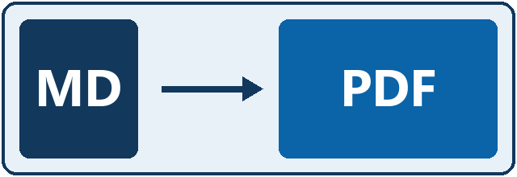

# Отчёт по проекту «Северный ветер»

Документ демонстрирует **все возможности** конвертера: заголовки, *курсив*,
`встроенный код`, [ссылки](https://example.com), таблицы, списки, цитаты
и блоки кода. Оформление целиком задаётся файлом `style.css`.

## 1. Цели и задачи

Проект должен показать, что **Markdown** годится для деловой документации,
а оформление — это отдельный слой, который можно менять без правки текста.
Длинный абзац нужен, чтобы проверить переносы строк и выключку по формату:
текст занимает несколько строк, межстрочный интервал должен оставаться
ровным, а поля страницы — одинаковыми со всех сторон.

### 1.1. Основные задачи

* Собрать PDF из произвольного числа файлов;
* сохранить единый стиль во всех документах;
* проверить предпросмотр до печати;
* не зависеть от установленного офисного пакета.

### 1.2. Порядок работы

1. Выбрать файлы .md в графической оболочке;
2. убедиться, что стиль и параметры страницы подходят;
3. нажать «Собрать PDF» и забрать готовые файлы.

## 2. Параметры сборки

| Параметр      | Значение по умолчанию | Примечание                          |
|:--------------|:---------------------:|------------------------------------:|
| Формат        | A4                    | A5, A3 и Letter тоже доступны      |
| Поля          | 16 мм                 | одинаковые со всех сторон          |
| Кегль         | 10 пт                 | задаётся в ГУИ или `--font-size` |
| Разрешение    | 300 dpi               | качество вставленных картинок      |
| Стиль         | `style.css`         | лежит рядом с программой           |

> Оформление — это не текст. Меняйте CSS, и весь тираж документов
> перерисуется при следующей сборке.

## 3. Пример кода

```python
def convert(source, target=None, options=None, stylesheet=None):
    document = build_document(
        source.read_text(encoding="utf-8-sig"),
        options,
        source.parent,
        stylesheet,
    )
    write_pdf(document, target or source.with_suffix(".pdf"), options)
    return document.pageCount()
```

В коде выше `build_document` получает текст стиля параметром, поэтому
оформление можно подменить на лету. Обратите внимание: разметка внутри
обратных кавычек, например `**не жирная**`, остаётся текстом.

## 4. Схема



---

## 5. Итог

Документ собран без офисного пакета, шрифты взяты из системы, а внешний вид
определяется одним текстовым файлом `style.css`. Такой подход удобен
для регламентов, инструкций и отчётов, которые нужно выпускать массово.

### Контакты

* Почта: `docs@example.com`
* Версия: 1.0.0
